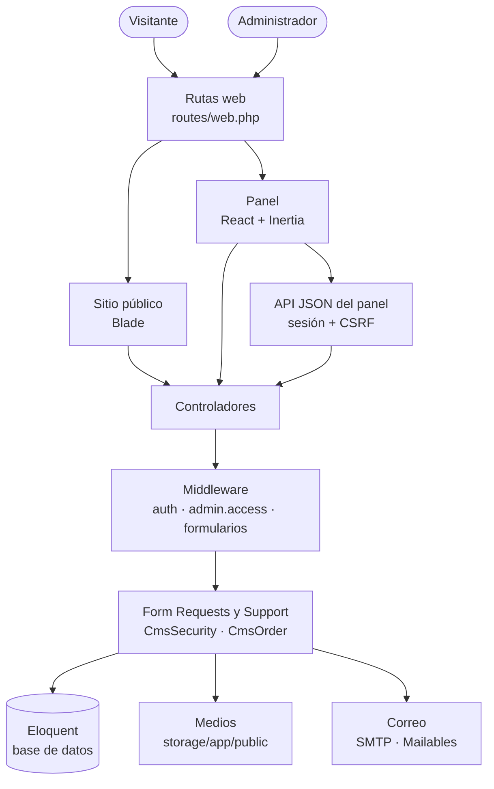
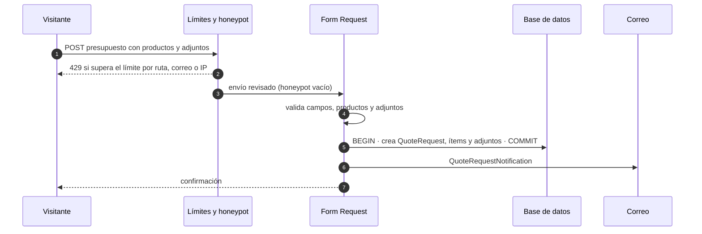
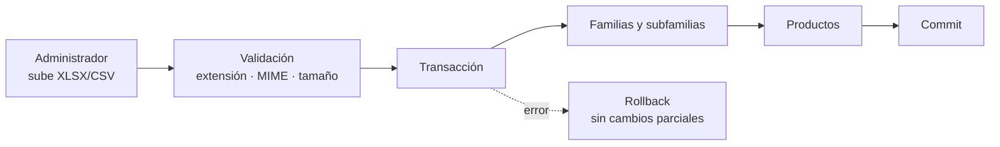
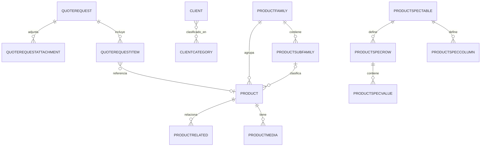

<div align="center">

<br/>

**Sitio corporativo y plataforma de contenido y catálogo técnico para una empresa B2B del sector industrial.**


-25A7CA?style=for-the-badge)

<br/>


</div>


## 📑 Contenido

- [El problema](#-el-problema)
- [La solución](#-la-solución)
- [Funcionalidades](#-funcionalidades)
- [Arquitectura](#️-arquitectura)
- [Flujos de trabajo](#-flujos-de-trabajo)
- [Modelo de datos](#️-modelo-de-datos)
- [Criterios y decisiones](#-criterios-y-decisiones)
- [Stack](#-stack)
- [Estructura del repo](#️-estructura-del-repo)
- [Puesta en marcha](#-puesta-en-marcha)
- [Pruebas y calidad](#-pruebas-y-calidad)
- [Despliegue](#-despliegue)
- [Estado y pendientes](#-estado-y-pendientes)
- [Licencia y autoría](#-licencia-y-autoría)


## 🧩 El problema

Una empresa industrial que vende a otras empresas necesita que su catálogo técnico sea consultable por familia, subfamilia y ficha, y que cada pedido de presupuesto llegue completo y con registro. Cuando el catálogo vive en archivos sueltos y las consultas llegan por correo, las fichas quedan desactualizadas y los pedidos se pierden o se repiten.

## 💡 La solución

Tarea SRL es un sitio público con catálogo jerárquico, fichas en PDF y solicitudes de presupuesto, respaldado por un panel administrativo que edita el contenido sin tocar código. Las consultas quedan guardadas, con sus ítems y adjuntos, y notifican por correo.

Roles que usa el sistema:

- **Visitante**: explora el catálogo, descarga fichas, pide presupuesto, catálogo o contacto y se suscribe al boletín.
- **Administrador**: usuario con acceso concedido (`can_access_admin`) que gestiona catálogo, contenido, medios, solicitudes, newsletter y usuarios.

## ✨ Funcionalidades

**Sitio público**
- Inicio, información institucional, calidad, clientes, representadas, novedades y contacto.
- Catálogo por familias y subfamilias, detalle de producto con galería, productos relacionados y tablas de especificaciones.
- Fichas técnicas en PDF.
- Buscador de páginas, categorías, productos, novedades, clientes y representadas, con sugerencias en JSON.
- Solicitud de presupuesto con productos seleccionados, ítems libres y adjuntos; solicitud de catálogo; formulario de contacto.
- Suscripción al newsletter.

**Panel administrativo**
- CMS por secciones, campos e ítems ordenables, con metadatos SEO y Open Graph por tipo de página.
- Productos, familias, subfamilias, clientes y categorías, representadas, publicaciones y enlaces sociales.
- Biblioteca de imágenes, documentos y videos con streaming HTTP.
- Importación masiva de familias, subfamilias y productos desde XLSX, XLS, CSV o TXT, y descarga de una plantilla XLSX.
- Campañas de newsletter a suscriptores activos.
- Dashboard con conteos, series de solicitudes y actividad reciente.

## 🏗️ Arquitectura

<p align="center">
  
</p>

Monolito Laravel con dos interfaces sobre el mismo backend: el sitio público se renderiza en Blade y el panel usa React con Inertia. Ambos comparten modelos, políticas de acceso y sanitización.



## 🔄 Flujos de trabajo

**Solicitud de presupuesto**



**Importación de catálogo**



## 🗃️ Modelo de datos



Las migraciones (27) definen claves foráneas con cascada o `NULL` según el ciclo de vida, slugs y correos únicos, y tablas pivote con restricciones compuestas. Las entidades principales están en `app/Models/`.

## 🧭 Criterios y decisiones

| Decisión | Por qué |
|---|---|
| Blade para el sitio y React/Inertia para el panel | El sitio público necesita render en servidor; el panel necesita interacción. Un solo backend evita duplicar lógica. |
| Especificaciones normalizadas (tablas, columnas, filas, valores) | Permite fichas consistentes y filtrables, en lugar de una matriz opaca por producto. |
| Importación en transacción | Un archivo con errores no deja el catálogo a medio cargar. |
| CMS relacional con secciones, campos e ítems | Páginas heterogéneas con claves e integridad referencial, sin crear una tabla por página. |
| Sanitización diferenciada (texto, rich text, URL, iframe) | Cada tipo de contenido admite solo lo que necesita; las reglas viven en `CmsSecurity`. |
| IP guardada como huella HMAC en los registros | Permite detectar abuso sin almacenar la dirección en claro. |
| Acceso al panel con `can_access_admin` | El permiso vive en el usuario, no en una lista de correos fija en el código (la lista queda solo como respaldo de esquemas anteriores). |

## 🧱 Stack

| Capa | Tecnología | Versión (composer.json / package.json) |
|---|---|---|
| Backend | PHP · Laravel | PHP ^8.2 · Laravel ^12.0 |
| Sesión y API interna | Laravel Sanctum · Ziggy | ^4.0 · ^2.0 |
| PDF | Dompdf (`barryvdh/laravel-dompdf`) | ^3.1 |
| Planillas | Maatwebsite Excel | ^3.1 |
| Inertia | `inertiajs/inertia-laravel` · `@inertiajs/react` | ^2.0 · ^2.0 |
| Frontend | React · Vite · Tailwind CSS | React ^18.2 · Vite ^7.0 · Tailwind ^3.4 |
| Componentes y animación | Headless UI · Iconify · Recharts · Framer Motion | ^2.0 · ^6.0 · ^3.8 · ^12.38 |
| Pruebas | PHPUnit | ^11.5 |
| Base de datos | MySQL recomendado (SQLite en pruebas) | según el entorno |

## 🗂️ Estructura del repo

```text
app/
├── Http/Controllers/   sitio público, panel, recursos JSON y autenticación
├── Http/Middleware/    acceso admin, formularios y cabeceras de seguridad
├── Http/Requests/      validación de login y perfil
├── Mail/               notificaciones de contacto, catálogo y presupuesto; campaña de newsletter
├── Models/             entidades Eloquent del dominio
└── Support/            sanitización (CmsSecurity), SEO, orden y blueprints del CMS
config/                 base de datos, correo, almacenamiento, sesión y seguridad
database/               migraciones y seeders
docs/                   especificaciones y planes históricos
resources/css/          estilos públicos y administrativos
resources/js/Pages/Admin/   panel React/Inertia
resources/views/        sitio Blade, componentes y correos
routes/                 web, autenticación y consola
tests/                  PHPUnit (Feature y Unit)
public/                 entrada web y assets
docs/readme/            assets de este README (SVG)
```

## 🚀 Puesta en marcha

Requisitos: **PHP 8.2 o superior**, **Composer**, **Node.js con npm** y una base de datos compatible con Laravel (MySQL es la configuración principal).

```bash
composer install
npm install
cp .env.example .env
php artisan key:generate
php artisan migrate
php artisan storage:link
php artisan serve             # en una terminal
npm run dev                   # en otra terminal
```

También existe `composer run dev`, que levanta servidor, cola, logs y Vite juntos.

Variables de entorno: se completan en `.env` a partir de `.env.example` con valores locales (conexión a la base de datos, correo y opciones de seguridad). No reutilizar credenciales de otros entornos.

## 🧪 Pruebas y calidad

- PHPUnit con suites `Unit` y `Feature`; las pruebas usan SQLite en memoria, caché en array, correo falso y cola síncrona.
- Pruebas presentes (8 métodos de prueba en total): descarga de medios, carruseles de inicio, nosotros y clientes, y contenido de productos y representadas. No hay pruebas E2E ni de carga versionadas.
- Comandos: `composer test` (limpia caché y ejecuta la suite), `npm run build`, `./vendor/bin/pint` para formato.
- No hay análisis estático ni CI versionados en el repositorio.

## 🚢 Despliegue

No documentado en el repositorio: no hay Dockerfile, pipeline de CI/CD, configuración de Nginx ni infraestructura como código. Respaldos y supervisión del proceso se resuelven en el entorno de alojamiento.

## 📌 Estado y pendientes

- **Estado:** en uso, con historial de versiones hasta la serie 1.1.x.
- **Último commit:** 26 de junio de 2026, `VERSION 1.1.7`.
- **Producción:** no verificado desde el repositorio.
- **Pendientes sugeridos:** ampliar la cobertura de pruebas al flujo de solicitudes y a la importación de catálogo; agregar CI y una definición de despliegue versionada.

## 📄 Licencia y autoría

Desarrollado por el **Ing. Santiago Abasto**.


Repositorio sin archivo de licencia. Código de uso del cliente Tarea SRL; no se distribuye sin autorización. Autoría: no especificada en el repositorio.
